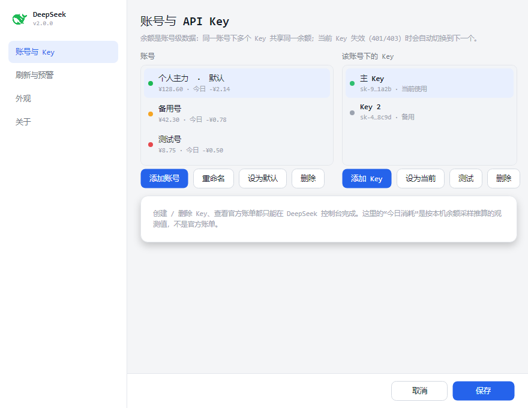
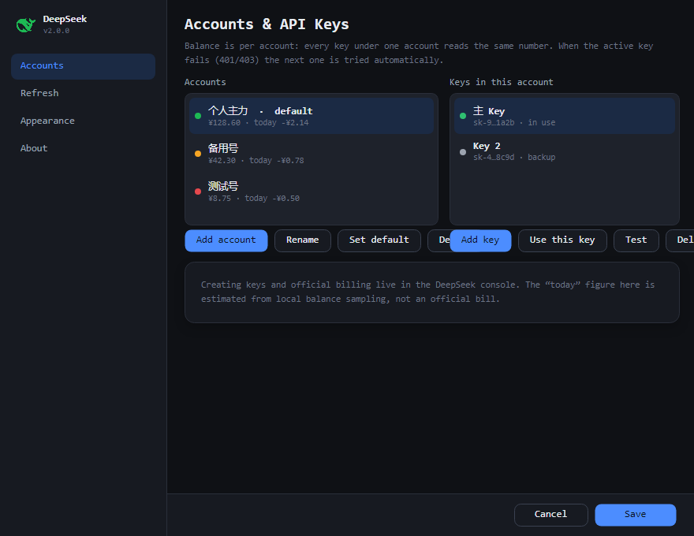
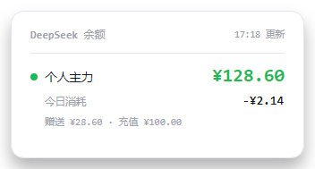
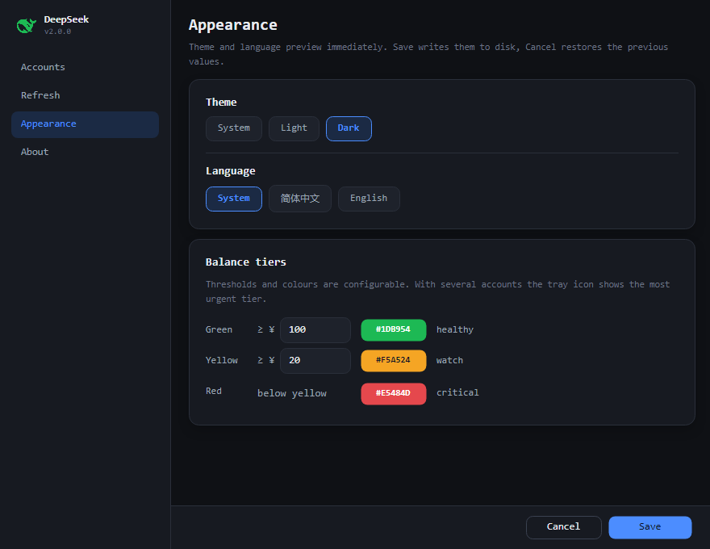
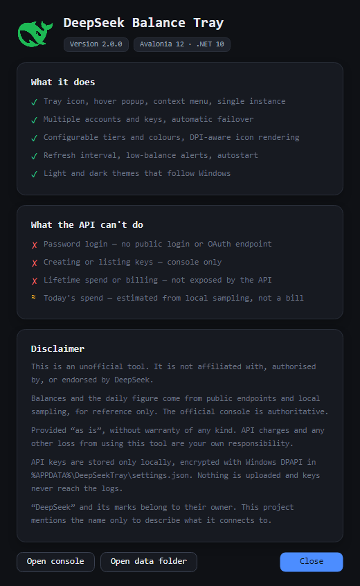

# DeepSeek 余额托盘（DeepSeek Balance Tray）

一个常驻 Windows 系统托盘的 DeepSeek 余额小工具：鼠标悬停看余额，按可配置的三段式阈值给托盘图标着色，余额过低时弹通知。支持中英文与浅色 / 深色主题。

> **非官方工具**，与 DeepSeek 官方没有任何关联，也未获其授权或背书。
> Unofficial tool. Not affiliated with, authorised by, or endorsed by DeepSeek.

- 目标框架：**.NET 10**（`net10.0-windows`）
- UI 框架：[Avalonia 12](https://avaloniaui.net/)
- 数据来源：DeepSeek 官方公开接口 `GET https://api.deepseek.com/user/balance`

---

## 隐私：不上传任何用户数据，密钥完全加密存在本机

这一节是明确的承诺，也是代码的实际行为：

| 承诺 | 实现 |
|---|---|
| **不上传用户数据** | 程序没有账号体系、没有统计埋点、没有远程配置、没有崩溃上报。除查询余额外不发起任何网络请求 |
| **唯一的外部通信** | `https://api.deepseek.com/user/balance`，只带上你自己的 API Key 做鉴权，不发送任何额外信息 |
| **API Key 加密存储** | 用 Windows DPAPI（`CryptProtectData`，CurrentUser 范围）加密后写入本机 `%APPDATA%\DeepSeekTray\settings.json`，文件里搜不到 `sk-` 明文 |
| **密钥不可跨机使用** | DPAPI 绑定当前 Windows 用户 + 当前机器；换机器或换 Windows 用户都无法解密 |
| **日志不含密钥** | `app.log` 只记录启动、刷新、异常等状态，不打印 Key 内容 |
| **余额数据只留在本机** | 余额与「今日消耗」写在同一个本地配置里，只为重启后先显示上次数字 |
| **删除即清除** | 删除 `%APPDATA%\DeepSeekTray\` 目录即可清除全部配置与密钥 |

> 边界说明：DPAPI CurrentUser 能挡住其他 Windows 账户，但挡不住"同一个用户下运行的其他程序"。
> 如果需要更强的隔离，应改用系统凭据管理器或加主密码——本项目没有做。

---

## 界面

| 设置 · 中文 | 设置 · English |
|---|---|
|  |  |

| 悬停浮层 | 右键菜单 |
|---|---|
|  |  |

外观页（主题 + 语言 + 三段式配色）：



关于页（含免责声明）：



托盘图标（`¥` 圆角方块，颜色随余额分级）：

| 32px | 16px（放大 8 倍，实际显示尺寸） |
|---|---|
|  |  |

---

## 功能

| 能力 | 说明 |
|---|---|
| 托盘常驻 | 启动即收进托盘，无主窗口；单实例，重复启动会唤出已有实例 |
| 悬停浮层 | 贴在托盘图标上方显示各账号余额、赠送 / 充值构成、今日消耗 |
| 右键菜单 | 自绘菜单：立即刷新 / 设置 / 打开控制台 / 关于 / 退出，跟随主题 |
| 多账号 / 多 Key | 账号下可挂多个 Key，主 Key 失效（401/403）自动切换 |
| 三段式配色 | 绿 / 黄 / 红阈值与颜色全部可改，托盘图标动态绘制 |
| 余额预警 | 低于阈值弹系统通知，同一状态不重复打扰 |
| 定时刷新 | 默认 5 分钟，可配 1–1440 分钟 |
| 中英文 | 默认跟随系统语言（**非中文一律英文**），也可手动锁定 |
| 浅色 / 深色 | 跟随系统或强制指定，标题栏一起变 |
| 今日消耗 | 按本机余额采样差值估算（见下方限制） |
| 空闲回收 | 静置后把工作集还给系统，长期挂着不会越吃越多 |

### 今日消耗怎么算

官方没有账单接口，所以这个数字是**本机观测值**：每次刷新比较「上次余额 − 本次余额」，下降计入消耗，上升视为充值不计入，跨天清零。只统计程序运行期间，关机时段的用量采不到。它**不是**官方账单。

---

## 构建与运行

需要 .NET 10 SDK。

```powershell
# 运行（Debug）
dotnet run --project src\DeepSeekTray.Avalonia

# 发布为单文件 exe（框架依赖，约 27 MB，需要 .NET 10 桌面运行时）
dotnet publish src\DeepSeekTray.Avalonia -c Release -r win-x64 --no-self-contained `
  -p:PublishSingleFile=true -p:IncludeNativeLibrariesForSelfExtract=true `
  -p:DebugType=None -p:DebugSymbols=false -o .\dist

# 免安装运行时（自包含 + 裁剪 + 压缩）
dotnet publish src\DeepSeekTray.Avalonia -c Release -r win-x64 --self-contained true `
  -p:PublishSingleFile=true -p:PublishTrimmed=true -p:EnableCompressionInSingleFile=true `
  -o .\dist-standalone
```

体积说明：框架依赖的单文件 exe 约 27 MB，其中约 16 MB 是 Skia / HarfBuzz / ANGLE 原生库——Avalonia 自带渲染栈，这是它的固有成本；换来的是自包含发布比 WPF 小一半以上（WPF 自包含约 71 MB）。

### 调试与自检参数

| 参数 | 作用 |
|---|---|
| `--preview <dir>` | 离屏渲染全部窗口（中英各一套）成 PNG，用于 UI 自检（仅 Debug） |
| `--memtest <log>` | 反复创建/销毁窗口并采样内存、句柄，用于排查长期运行是否有累加（仅 Debug） |
| `--selftest` | 无界面自检：分级算法、JSON 解析、DPAPI、图标渲染 |
| `DTS_FAST_TRIM=1` | 环境变量：把空闲回收周期从分钟级缩到秒级，方便验证 |

---

## 数据与配置

| 内容 | 位置 |
|---|---|
| 设置 + DPAPI 加密后的 Key | `%APPDATA%\DeepSeekTray\settings.json` |
| 运行日志（不含密钥） | `%APPDATA%\DeepSeekTray\app.log` |
| 托盘图标缓存 | `%TEMP%\DeepSeekTray\tray-*.ico` |
| 开机自启 | `HKCU\Software\Microsoft\Windows\CurrentVersion\Run\DeepSeekTray`（仅开关时写入） |

移动 exe 不影响配置读取（配置跟 `%APPDATA%` 走）。若开着开机自启，移动后打开设置点一次「保存」重写注册表路径即可。

---

## 内存行为

托盘程序大部分时间没有窗口。项目里有一个 `MemoryJanitor`：每 45 秒检查一次，在**没有浮层 / 设置 / 菜单显示**且静置 60 秒后（最快 5 分钟一次）执行：

1. 关闭长期不用的浮层窗口（下次悬停重建，约 30 ms）；
2. 一次 `GC.Collect(2, Optimized)`；
3. `SetProcessWorkingSetSize(-1, -1)` 把工作集交还系统。

实测：启动约 84 MB 工作集，静置两分钟后回落到 **13 MB** 左右；`--memtest` 压测 40 轮反复建窗，句柄与线程数保持平稳，托管堆稳定在 3–6 MB，没有累积。

---

## 目录结构

```
DeepSeekTray/
├─ DeepSeekTray.slnx
├─ LICENSE                      MIT
├─ THIRD-PARTY-NOTICES.md       第三方组件许可与商标声明
├─ README.md
├─ docs/                        截图
└─ src/DeepSeekTray.Avalonia/
   ├─ Program.cs                入口、软件渲染配置
   ├─ App.axaml(.cs)            单实例、激活信号、全局异常
   ├─ Theme/
   │  ├─ Palette.axaml          浅色 / 深色调色板（ThemeDictionaries）
   │  └─ Styles.axaml           卡片、按钮、复选框、菜单行等样式
   ├─ Localization/
   │  ├─ Loc.cs                 中英文案表
   │  └─ TrExtension.cs         XAML 标记扩展 {loc:Tr Key}
   ├─ Models/AppSettings.cs     设置 / 账号 / Key / 余额 / 分级 / 今日消耗
   ├─ Services/
   │  ├─ AppController.cs       托盘、轮询、预警、今日消耗（核心）
   │  ├─ TrayIconHost.cs        Shell_NotifyIcon 原生托盘（悬停 / 右键 / 气泡）
   │  ├─ IconFactory.cs         Skia 绘制 ¥ 图标，多尺寸 ICO
   │  ├─ DeepSeekApiClient.cs   /user/balance 客户端与解析
   │  ├─ BalanceTier.cs         三段式分级（纯函数）
   │  ├─ Dpapi.cs               DPAPI 加解密（P/Invoke）
   │  ├─ SettingsStore.cs       settings.json 读写
   │  ├─ MemoryJanitor.cs       空闲工作集回收
   │  ├─ Autostart.cs           HKCU Run 键
   │  └─ Native.cs              Win32 互操作
   ├─ Views/                    设置 / 浮层 / 菜单 / 关于 / 对话框
   ├─ MemTest.cs                --memtest
   └─ PreviewMode.cs            --preview
```

---

## 已知限制

- **账号密码登录**：官方没有公开的登录 / OAuth 接口，所以用 API Key 绑定账号。
- **创建 / 列出 API Key**：只能在官方控制台操作，本工具提供跳转。
- **官方累计消费 / 账单**：`/user/balance` 只返回当前余额构成，没有历史消费，因此不显示"总消费"；「今日消耗」是本机估算。
- **繁体中文**：目前按 `zh` 前缀判定，zh-TW / zh-HK 也会显示简体文案。

---

## 许可与免责

- 自有代码：[MIT](LICENSE)。
- 第三方组件（Avalonia / SkiaSharp / HarfBuzz / ANGLE 等）均为宽松许可，分发二进制时需保留声明，详见 [THIRD-PARTY-NOTICES.md](THIRD-PARTY-NOTICES.md)。
- `DeepSeek` 名称与鲸鱼标识归其权利人所有；仓库里的应用图标使用了该品牌标识，**不在 MIT 授权范围内**，如需公开发布建议替换为自己的图标（托盘图标为本项目原创）。
- 软件按"现状"提供，不附带任何担保；使用产生的 API 费用与风险由使用者自负。
